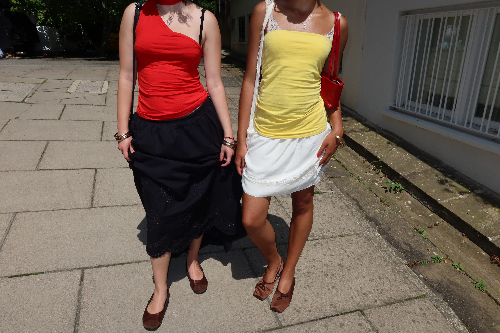

In recent seasons, the term ‘recession indicator’ has been used to describe many of the trends surfacing lately. Although it seems drastic, if we look at some of the recent trends there is in fact a lessening of our style maintenance. Essentially, we can see this season’s trends utilise more accessible trends, whether it’s lessening the perfect, matching fit that we have seen for the past few years or really making use of what’s already in our wardrobes, this ‘less is more’ mindset is definitely a positive twist for fashion.

Furthermore with an increase in vintage shopping, one of a kind pieces are bringing back a sense of appreciating individuality and pieces that are meant to last longer than the latest microtrend. Second hand shopping has also enabled a sense of further accessibility to more styles that are also affordable, allowing people to refresh elements of their wardrobe in a long-lasting way, making us less impressionable as consumers of the 21st century. The fashion industry, particularly the fast fashion sector, is one of the most polluting industries in the world, and as droughts and fires have also been a global, summer trend, these current fashion movements are bringing a new sense of direction in which environment and fashion are more compatible.

1. Flip Flops, Shoe of the Summer

Firstly, we cannot talk about S/S 26 without recognising the power of the humble flip flop. Havaianas have been collaborating left and right, creating all kinds of designs, from their DWP2 puffy flip flops collab to their 3D printed collab with Zellerfeld and their bohemian collection with Isabel Marant. Whether it’s a shiny new Versace rubber flip flop or a classic high street, heeled black flip flop, it is clear the new summer shoe essential has been stripped back to a shoe everyone can access. Whereas in past seasons we have seen chunky, encrusted crocs or bright coloured stilettos as summer fads, the resurgence of the flip flop as a day to night staple shows the new essentialism of summer fashion.

2. Bare Nail Trends

A new, slightly controversial twist to the mani of SS26 is that there isn’t one. More and more women are ditching the done up acrylics and gel nails for bare, well kept nails - glassy, nude, clean. Ultimately this surfaced from celebrities and upper class women who have seen the new, easy accessibility of acrylics and have opted for an effortless look that differentiates them. While this trend carries a sense of inaccessibility as it’s meant to represent a lifestyle of seemingly low maintenance for people who have the time for high maintenance, at the end of the day it is a trend easily adaptable for everyone. A simple gloss coat and cuticle clean and you’re ready for the day, while it tries to appear exclusive it’s a signal that everyone’s ready to strip back their routines to the least effort and shows what direction our styles are heading.

3. Skincare over Makeup Epidemic

Although with Zara Larsson glam taking over SS26, it is safe to say that the minimalism makeup is still very much prominent as the focus on skincare increases by the day. With less emphasis on eye makeup, coloured eyeshadows and bold eyeliners, it seems the only makeup products in use are a gentle bronzer, a brow tint and a sweep of subtle gloss on the lips. The rest of the face is glassy, bare and already primed from the array of skincare steps that have taken over day and night routines. Even Dua Lipa’s new brand, DUA, has dropped as a skincare line as opposed to the typical celebrity makeup line. Hailey Bieber’s makeup line, Rhode, has also dropped a summer collection of these bare faced essentials, from bronzer to lip balm, it seems we are experiencing a true bare faced summer.

4. Colour Mis-Matching, So-Called Ugly Colour Combos

Finally a trend a little less monotonous, there is a very strong emphasis on ‘ugly colour combos’ lately, from turquoise and maroon brown to fiery orange and dusty purple. Ultimately, we are seeing the perfect coords leaving the scene and bold mis-matching taking its place. While it seems perhaps a little too strong for a ‘less is more’ look, the essentialism of this trend comes from using pieces you already have to create a look that may not be a conventional match but creates a perfect pair due to the charm of each piece. Finally the colours and pieces from people’s wardrobes that were hidden away due to their styling difficulties are making a comeback to prove mismatching is chic and effortless.

5. Sleek Jewellry

Whereas the early 2020s brought us bright, chunky pop rings and novelty earrings, SS26 seems to be about digging out the classic metallics in an all matching sleek look. Rather than using so many different jewellery pieces to accessorise, people seem to be more akin to picking a statement necklace and keeping the rest to basic metallics to accentuate already bold outfits. Even mixing metals has become more prominent as people are steering further away from matching all aspects of their outfit to create a more personal, interesting look that embraces the new sense of effortless styling with less conventional pairings.

6. Louder Statement Pieces

Even though certain aspects of minimalism are certainly being embraced, quiet luxury is definitely on its way out, with louder statement pieces taking center stage in most showrooms. Essentially, people are more willing to spend extra on longlasting, statement pieces from slow fashion brands over the constant wear and tear of fast fashion. Through this, people have been making more personal choices in their wardrobes over constantly adapting to internet trends and fads, creating timeless wardrobes for themselves. Although louder can sometimes be seen as going for bigger and better pieces, in this trend it seems to be more about making informed and slower decisions that are stripping people’s consumerism down to pieces they love rather than building up eccentricities.

Overall, SS26 is without a doubt following trends of individualities and unique outfits you choose, so it really is about self expression and the end of the day. If there is anything to take away from these trends, if you’re interested in adapting them into your style, would be to consider the ‘less is more’ attitude and fall in love with pieces forgotten in your wardrobe and consume pieces that truly stand out to you.

