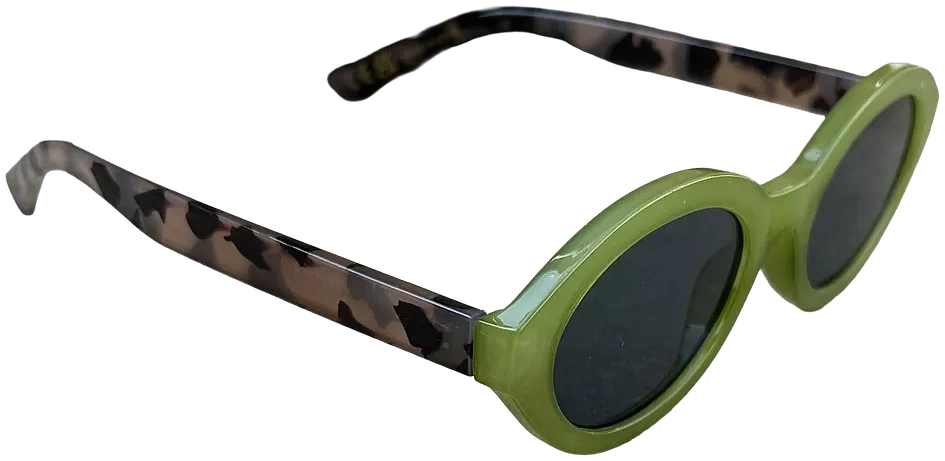
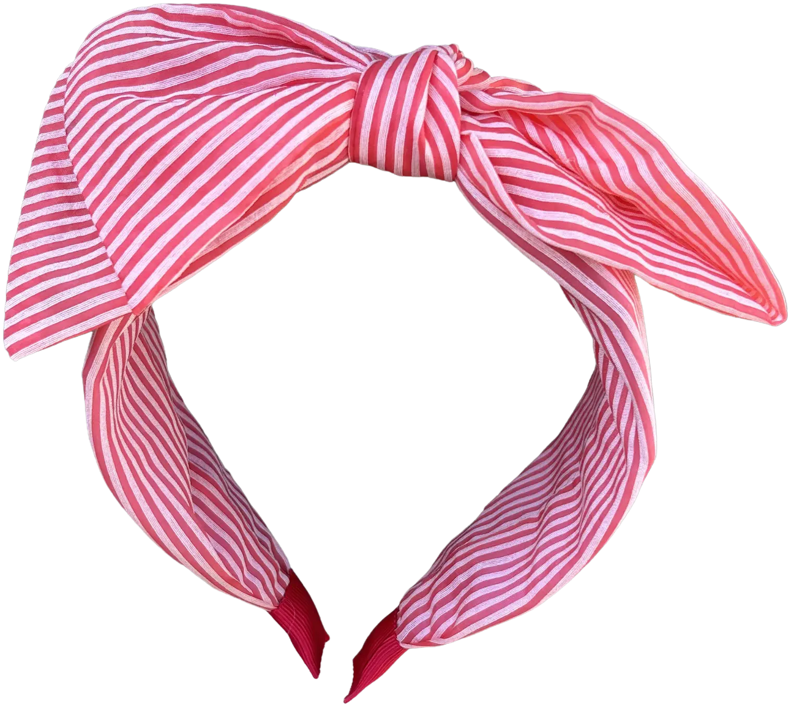
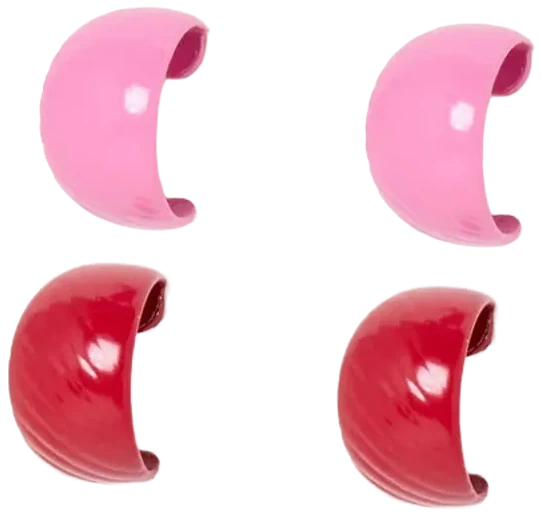
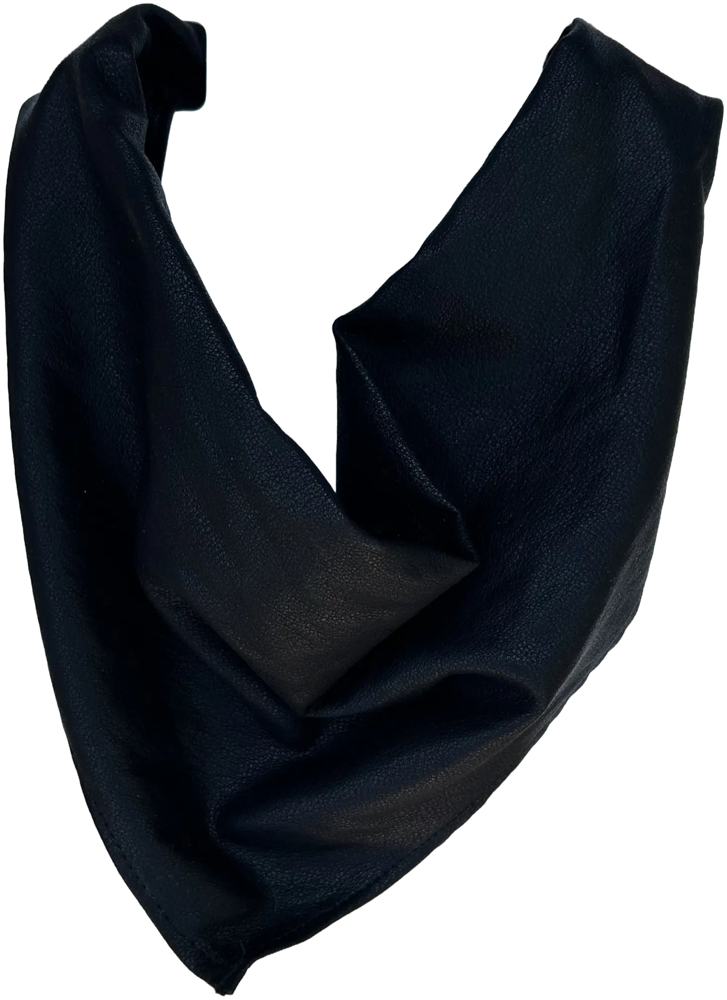
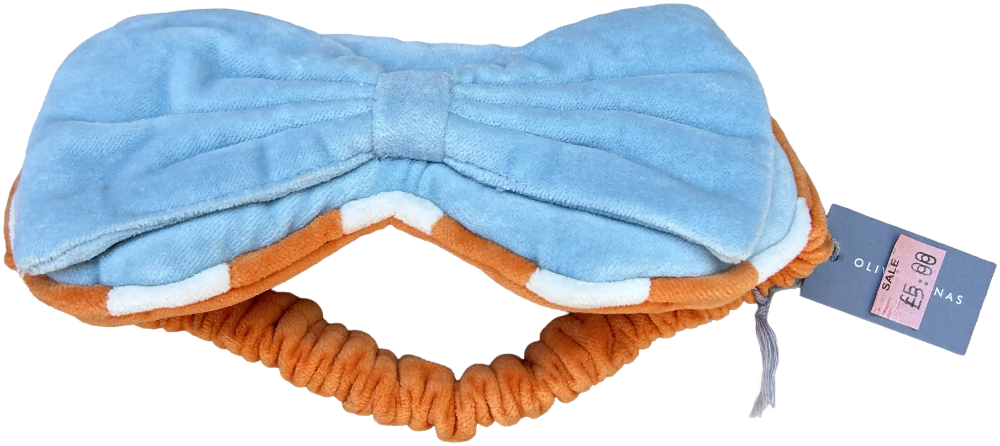

Following our recent summer fashion post all about stripping it back, let me put you on to the accessory theory - how statement choices can elevate an outfit on the more basic side.

It’s summer. All we want is a carousel of basics; think fitted cotton tees in light grey marl and white. I’ve been building my looks by implementing these simple choices during uk heatwave season, repeatedly telling myself: you can’t go wrong. No one can ever hate on a timeless ensemble! But, this is where accessories come in - how do I go from the put together city girl in her high-street basics to the girl who gets all the attention walking along Oxford Circus? This is where you need headbands, shades and jewellery (in bold hues). Here are a few of my faves from August:

1.

These sunglasses with their olive frames, tortoise temples and oval shape are the perfect recipe for chic! I’ve been doing the classic black Weekday ones for a while now, so it was time for a colour switch. Green is right at the top of my palette this summer and I’m picturing these with a red & white stripe, one-piece swimsuit - perhaps in Porto? They are sure to bring wow factor to any toned-down fit.

2.

I love a headband. Hats will always claim top spot but a good headband is a close second. I used to buy them from Claire’s and they would typically come with a side of bow and some encrusted pearls. I find it hard to find a trusty one nowadays - for a casual look I’d opt for a jersey one in black/grey, but this summer I’m going bold with this red, white and striped choice. Imagine this with those green shades as a look: vintage 50s summer unlocked!

3.

Let’s talk earrings - as they are my favourite jewellery. I’ll always prioritise a hoop, but I also like something in-between a hoop and stud - which is exactly what these are! Oliver Bonas do the perfect red/pink mini hoop combo which is great for seconds. I’ve gone for a bigger gold hoop first but these are equally cute solo! You can also find these in a royal blue/brown colourway in store.

4.

This triangle scarf is one of those things you have to imagine on - it ties in a bow at the back. Neck tie or hair bandana, you choose! I’ve been eyeing one of these up ever since I saw a girl arriving at my London dance class in one. It was black and red and patterned and looked so effortless with her fitted tee and tailored trousers. I jumped up and done when I saw this in the sale!

5.

Can’t say this really counts but I guess you could call it flight glam! I don’t usually do well with eye masks and would rather not suffocate my eyes - until I’m reminded of how Audrey Hepburn pulls hers off in Breakfast at Tiffany’s. As far as they go, I think this example is quite cute and was definitely worth it at the reduced price of £5. It will definitely do for the night flight I have booked in a couple of weeks.

So now let me rank my recent purchases in order of ‘most to least excited about’ (not that I regret any of them).

1. Shades
2. Triangle scarf
3. Headband
4. Earrings
5. Eye mask

Catch me wearing these on my Instagram in the next post @scarletsomerville (most probably).
