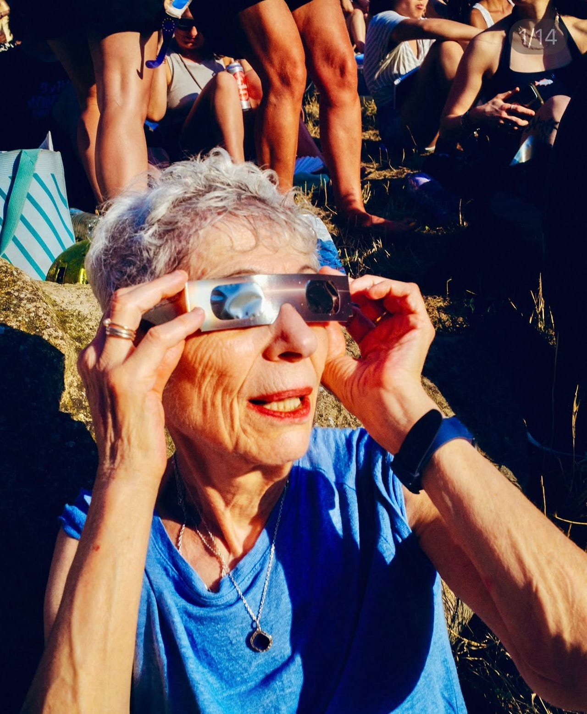
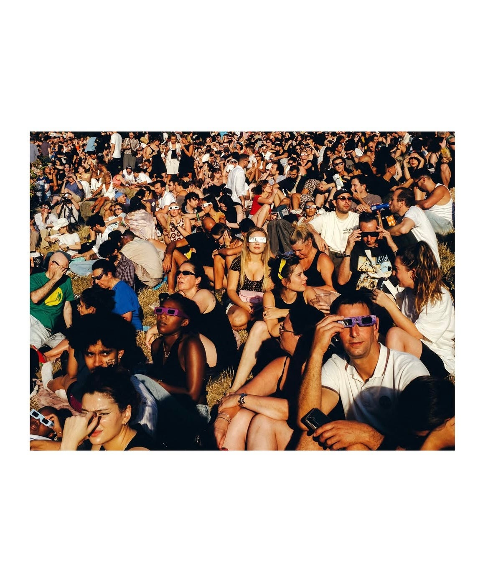
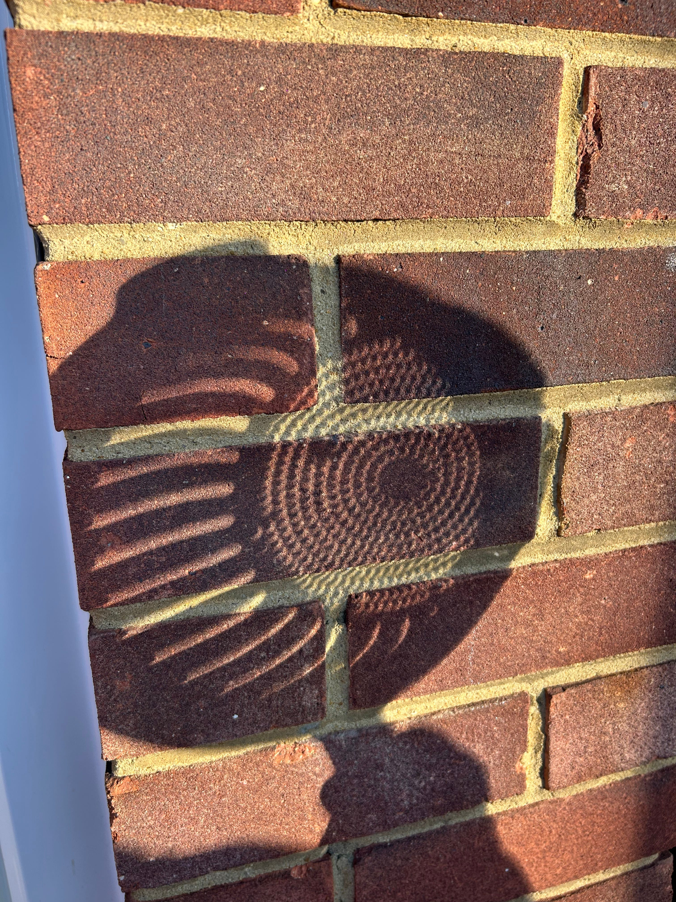
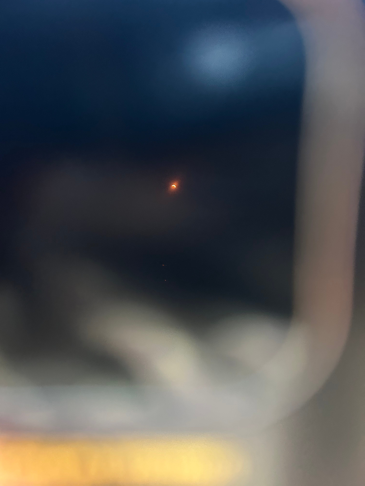

I can’t help but feel at a major loss right now (post eclipse). My neighbour, who is a scientist, knocked the door Monday morning with a pair of the special glasses for me. At this point I didn’t even know it was happening, let alone that people were planning in advance for the ‘big’ event! Did I slightly turn my nose up at them? Admittedly. I just couldn’t see myself a) remembering at the moment it was due to take place and b) being at all interested to be honest.

Fast forward to Wednesday evening. My nan was telling me she’d seen on the Internet that certain cultures avoid the ‘cursed’ eclipse at all costs and that it’s supposed to bring misfortune - I was even less excited. But on the other hand, the news channel seemed to be going mad for it, and I felt like I owed my neighbour my interest given he’d gifted me these glasses.

As I realised that people were actually queuing for the cardboard specs and they were being treated as a rare treasure, I began to think they were kind of cool. Not in a fashionable way, but just in a - wow everyone wants what I have - kind of way.

So, I spent the eclipse in my garden, in a leopard print pj set and messy hair, accompanied by neighbours. I even opened a packet of sweet popcorn - I must’ve been excited. Now where did I go wrong? Did you see the pics I took? At the time, the last thing I wanted to do was start adding to the 20,578 photos I already have in my camera roll. Also, I’ve already come to realise that photographing anything sky/space related is a complete waste of time as the phone never does it justice. I was quite satisfied with the very mediocre picture I got plus the few my mum took of me in my leopard print pyjamas smiling at the camera on our front doorstep.

Then, I unlock my phone to see the most cinematic street photography ever to be posted by Another Magazine and Charles Hemon of strangers modelling the eclipse glasses like they’re so in vogue. It was almost like the return of the retro 3D glasses you’d get at the cinema, and I missed out on the photograph. The real motive was at Parliament Hill in Hampstead Heath, obviously, and to think I put zero effort into the function that the whole world seemed to be attending.

@charleshemon photography on Instagram

@charleshemon

For the next one (when I’m in my 70s or 80s) I shall restyle these glasses gifted by my neighbour and maybe put a curler in my hair, paint my lips red and arrange to be photographed by the next Barney Curran, so I can post it on my Instagram. I’d add either the song Sexy Boy by Air or Kinky Love by Pale Saints, they’d suit the aesthetic just right.

Vs my attempt:

Little reflected moons taken on my iPhone

