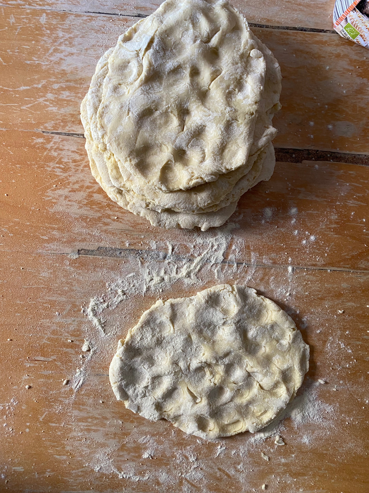
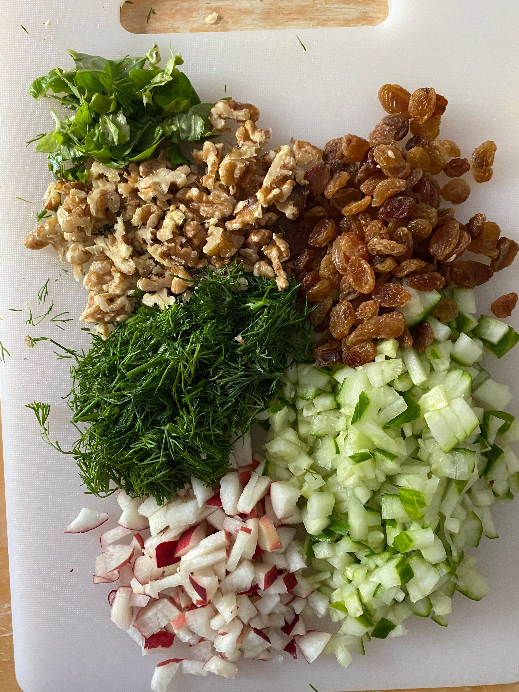
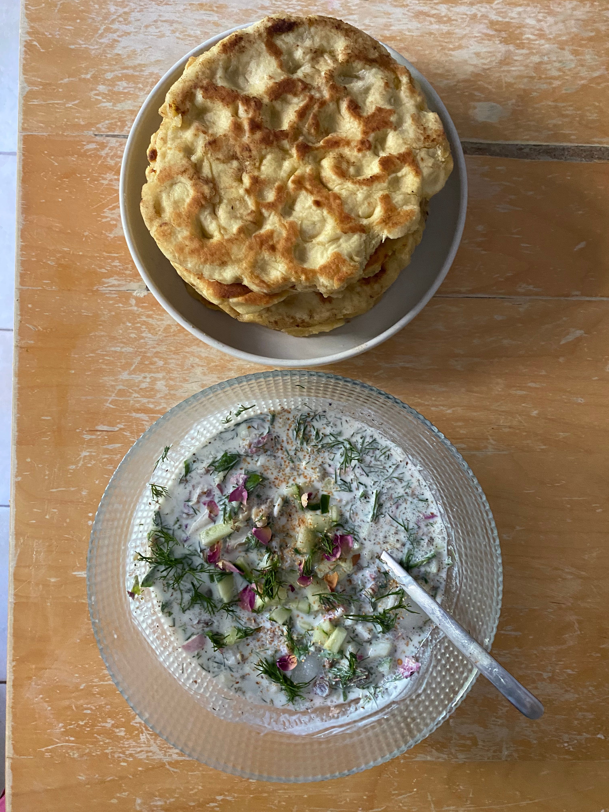

Out of a new series to watch and seeking sanctuary in my air-conditioned house, I rewatched Nora Ephron’s ‘Julie & Julia,’ where a young New Yorker starts a blog, recording her working through Julia Child’s 524 recipes in one year. As a movie I highly recommend, it’s light and captivating and you can’t help but fall in love with Julia’s life in 1950s Paris. What I cannot imagine recommending, is taking on a challenge as big as completing a full cookbook. It’s definitely possible and as seen in Julie’s case, enjoyable when you begin to form a parasocial connection to your chef of choice, but I couldn’t imagine dedicating all my meals to one person’s style of cuisine. Instead if there were any challenge I would set myself it would be to try to recreate as many different cuisines as possible, to learn what distincts each culture and what some people cherished as their childhood dish. For now however, I want to try and get closer to cuisine from my region, to know Mediterranean, balkan, and Middle Eastern dishes by heart and make them from the heart.

Yesterday this just happened to take the form of cold, yoghurt soup.

I wasn’t sure if this dish constituted the term soup, as much as it did a savoury yoghurt dish, but surely enough soup is defined by a base such as water, milk or stock and in this case it just happens to be water and yoghurt.

As true for most Anatolian dishes, there are several versions, passed from culture to culture and altered in small, personal ways. The origins of cold yoghurt soup are from Persia, a dish called Abdoogh Kiar, that has over the years lent a hand to the creation of Turkish Arian Asi and balkan Tarator. The main takeaway from each version to take note of, is it’s a perfect, cooling palette for a hot, summer day.

To accompany, I made some pan-fried flat bread, which pairs amazingly with the soup. The idea of making bread can sometimes be daunting, but honestly I believe it’s the perfect pastime and a very fool-proof method. I think making bread isn’t difficult, but forcing yourself to spend time on one meal can be. However, in this digital age, online detox is always a perfect way to spend an afternoon, and beginning small hobbies like this is always a rewarding way to pursue it.

Onto the recipe now!

Ingredients:

- thick, Greek yoghurt
- cold water
- ice
- fresh basil
- fresh dill
- cucumber
- peach
- dried rose petals
- dried mint
- dried garlic
- raisins
- walnuts
- salt
- pepper

You’ll notice I didn’t put any measurements as I don’t think it’s necessary. Everyone has different preferences on their herbs and what flavor they want to stand out. For me, I followed the emphasis on adding dill, however in retrospect I wouldn’t have added so much, therefore I think it’s important people tailor recipes to their tastes.

As for the assemblage:

1. Chop up all your fresh herbs, cucumber, peach (this was my own choice as it’s the fruit of the season but again it’s up to you), walnuts, and dried roses. It’s important that the cucumber is diced and that everything is quite fine so as to blend together better.

2. In your bowl, add a few tablespoons of yoghurt and some cold water and stir together until it forms a smooth base. If you want it thicker, add some more yoghurt and if you prefer a runnier texture, more water. Add the ice.

3. Stir in all your chopped and remaining ingredients et voila!

Use your bread to dip in the soup and enjoy on a hot balcony to cool you down!

I suppose, the idea of milky, water soup is not for everyone, but I promise with the first mouthful you’ll fall in love! It’s a great combination and for many it might become a summer staple. I will note, that it is not a particularly moreish dish, you definitely cannot have more than a small bowl at a time due to the sheer amount of aromatic herbs, but it’s definitely a dish to bear in mind for days you’re not so keen on a big, hot meal but rather a light, airy meal.

If anyone does try it, please let me know how it goes and perhaps this is the start of my new food blogging era, but not quite in the style of Julie Powell.
