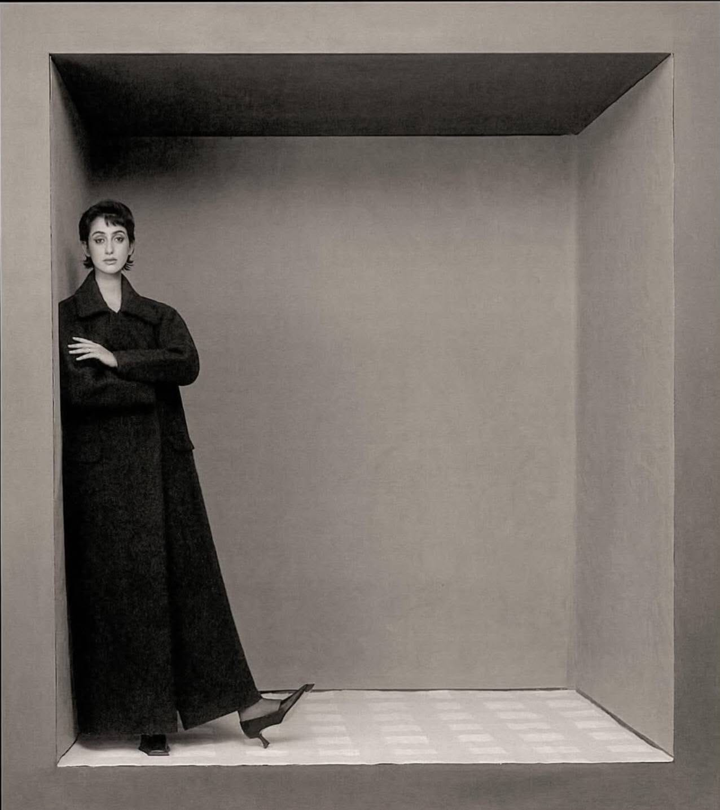
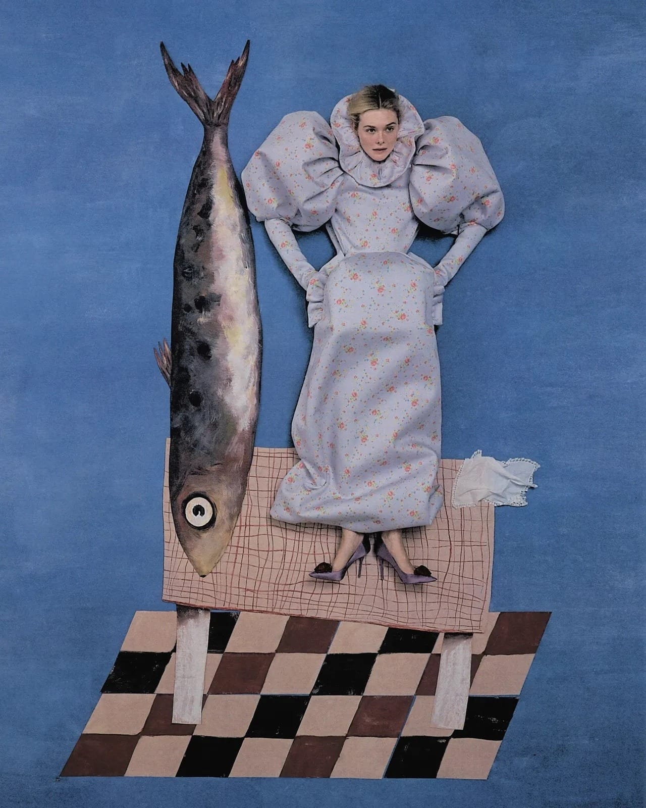

import { Annotation } from "#lib/assets/blog";

Welcome to my new column which I've decided to call "Artists of Our Time," the name may change if I think of something more clever - suggestions open. But for now I want people to know exactly what they'll be reading and that is current artists who I believe are changing the art history landscape. Of course, it is more or less based on artists who have caught my eye, but rest assured - I do have a degree in History of Art so my choices are informed rather than this being a random internet rant. I used to have a series called 'Women Who Metamorphosed Art,' which I really enjoyed writing and researching so it felt like the right time to start a new series, this one aiming to hopefully open your eyes to some current amazing artists and be able to follow their work as they're being made.

<Annotation>
	Rama Duwaji by Szilveszter Makó for The Cut, 2025.
</Annotation>

For all magazine connoisseurs, one brilliant vision has been steadily on the rise and it belongs to Szilveszter Makó. As a former painter, Makó's new art direction in editorial photography is deeply informed by the soft, picturesque qualities of oil paintings. More importantly, his photographs are bringing older art forms like surrealism to center stage, refreshing our concept of a fashion magazine to being more than just a photograph, but a dreamscape. Thus, why we are claiming Makó as an artist of our time.

For context, Makó's works have been featured as the covers for The Cut featuring Rama Duwaji, Vogue featuring Daisy Edgar Jones and 72 featuring Rihanna, alongside several other star studded shoots. When looking at all of these shots, Makó's voice is clear and his style easily recognised. Essentially we witness the same level of stillness as an oil painting and the idea that these subjects have been posing for days, when in fact it is instantaneous photography. As a result, it gives viewers a more polished, serious result that is reminiscent of 18th century upper class portraits with a modern, fashion twist.

The other twist in Makó's works is the devotion to surrealism. Founded in the 1920s, surrealism transformed the meaning of art, whereby paintings and photographs were no longer meant to simply capture a moment of time but to create a new world, and to imagine beyond the realms of the ordinary. The reason this was powerful at the time was because it allowed people a chance to escape and to explore their own consciousness. Makó using surrealism is therefore incredibly powerful to cut through the structured, staged movements and positioning of each subject, each prop and each background to become a more freeing composition. Willem Dafoe's face coming out of a detached house, Elle Fanning next to a giant sardine. We don't know what's going on - but it works, just as it did in the 1920s.

<Annotation>
	Elle Fanning shot by Szilveszter Makó for Who What Wear, 2026.
</Annotation>

In many ways, the fact this works doesn't make any sense. We are living in an age a century after the revelation of surrealism, we have access to more tools that can create imaginative works and we are deep into an internet culture that is already altering our sense of reality. Why would these shoots carry such powerful imagery when we are able to ask AI to create the very same image, when there are far more bizarre things to look at? Well, we now have to consider that the new form of escapism is steering as far away as possible from AI and digital art and seeing the value and talent in human imagination and creativity. Therefore, seeing a piece by Makó that represents this value of traditional art really connects people to the work and sees beauty in art that is produced by real people creating unique concepts.

Especially the shoot for the 2025 issue of The Cut featuring the First Lady of New York, Rama Duwaji, shows how Makó's vision stays classic throughout time and true to the subject's character. From the hand painted backgrounds and vintage colouring to the classic, Duwaji black outfits, this shoot represents a breakaway from the oversaturated trends that circulate to a visual that is timeless and individualistic. The insertion of the box prop adds an element of eclecticism but stays informed and symbolic, with these photos clearly referencing artists of the 20th century such as Irving Penn and Frida Kahlo. Most importantly, this shoot has been analysed over and over again, being a central topic within the art world, showing how Makó is not just building a voice of his own, but grabbing the world's attention and becoming a future reference in the history of art himself.
