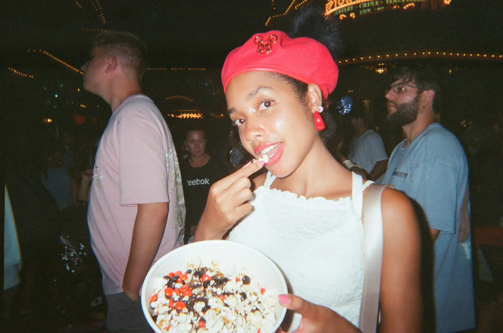
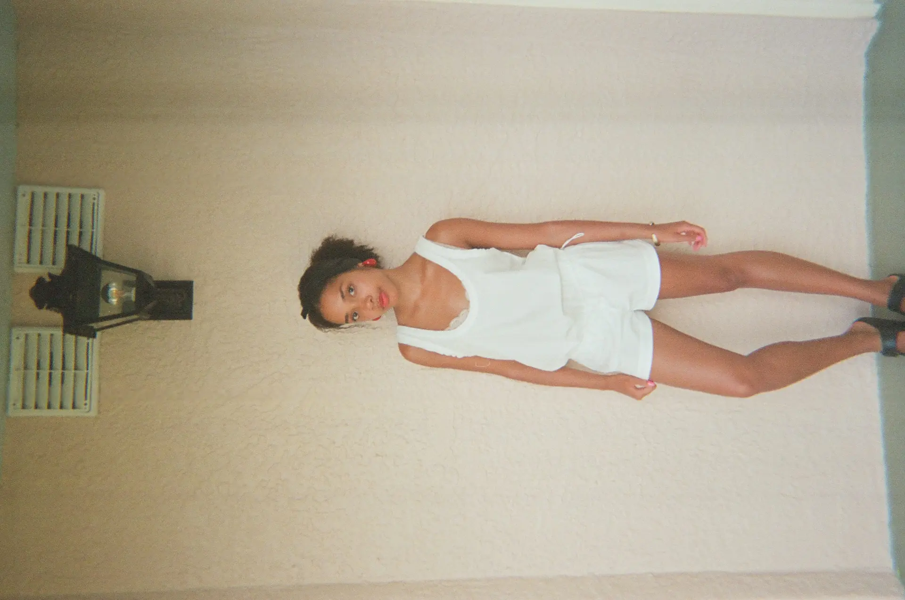
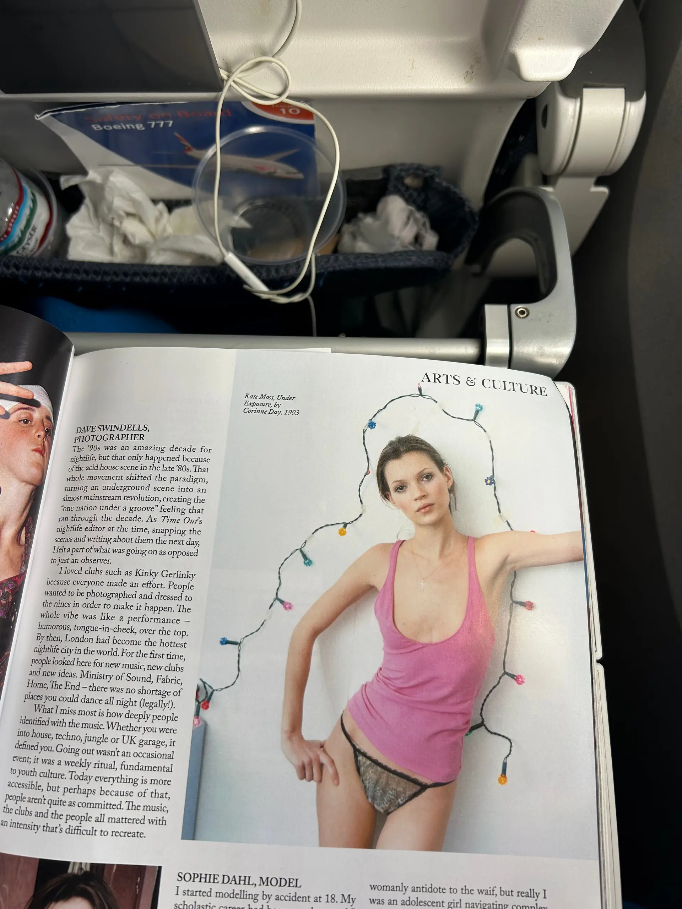

Hi I'm officially back from my holiday in Florida and counting down the days until I start my Master's (in Musical Theatre) which means moving out all over again. Summer has been a slow one, the product of no job, but no judgement is allowed as it was one rejection after another this year. If I had been working loads I don't think I would've had the time to really invest in our Substack, so I see this as my little gift.

I have some exciting news to share: Brick Wall is going to London Fashion Week! We were sent an invite by a brand on Friday (which I will disclose more info about at the end).

Since being home, I got my hol dispos developed and was sent the digis (abbreviation overload) the same day! I've never had this before and I'm so pleased there were no problems, after hearing horror stories about how airport security X-Rays can destroy film. Here are a few:

I went on my first run in ages this morning. I've kind of ditched outdoor running for the comfort of the treadmill, but I forgot how good a Sunday morning slow jog felt with the breeze, the leaves and other runners who smile supportively as they trot past.

Overall I am LOVING (in all caps) autumn. I left the UK in late August during the hay pandemic when green grass was a thing of the past. Now I'm back and the earth has been replenished, it's back to school era and my mum and I have returned to our good old Gilmore Girls (still on season 3).

Here are my current likes:

- sheer tops
- minimalist earrings like small, understated gold studs
- the film Moonlight (watched on the plane)
- exploring the local community (the other day I joined my local library)
- t shirts (I just bought a red, vintage Corvette one)
- stationery buying
- martinparrstudio on ig
- zebra crossing editorials
- #TheDieselFW26 campaign
- Halloween aisles

Yesterday I went into London to get last min bits for my upcoming MA. New trainers were on the list and I don't think I've appreciated putting on a pair of Nikes more; I wore the heeled boots I got for New York in Jan and thought they'd passed the 'wear in' test. Apparently not, my feet were in agony so the sight of Sports Direct was a godsend, I love my new triple black Nike Reax.

I'm halfway through the Vogue September issue and I'm loving it. I was a bit disappointed by the airport selection so it had to be Vogue, although I also picked up Dazed, because it's usually my favourite alongside i-D. I was late to The Action Issue but if I'm being honest it was a print worth skipping. This season's Vogue has so many stories for its readers to listen to and learn from - highlights include both the Show & Tell and Smoking Age articles, shared mems of the '90s feature and Brit Young Things shoot.

Back to our big news! We will be interviewing the designer Ray Chu at this season of LFW. We're no strangers to their label, having visited an exhibition featuring their collection last September. We also have tickets for the SS27 Presentation and Ignite Collective Runway happening on Friday and Saturday! I need to get my designer research on and outfit sorted, only four days to go...
