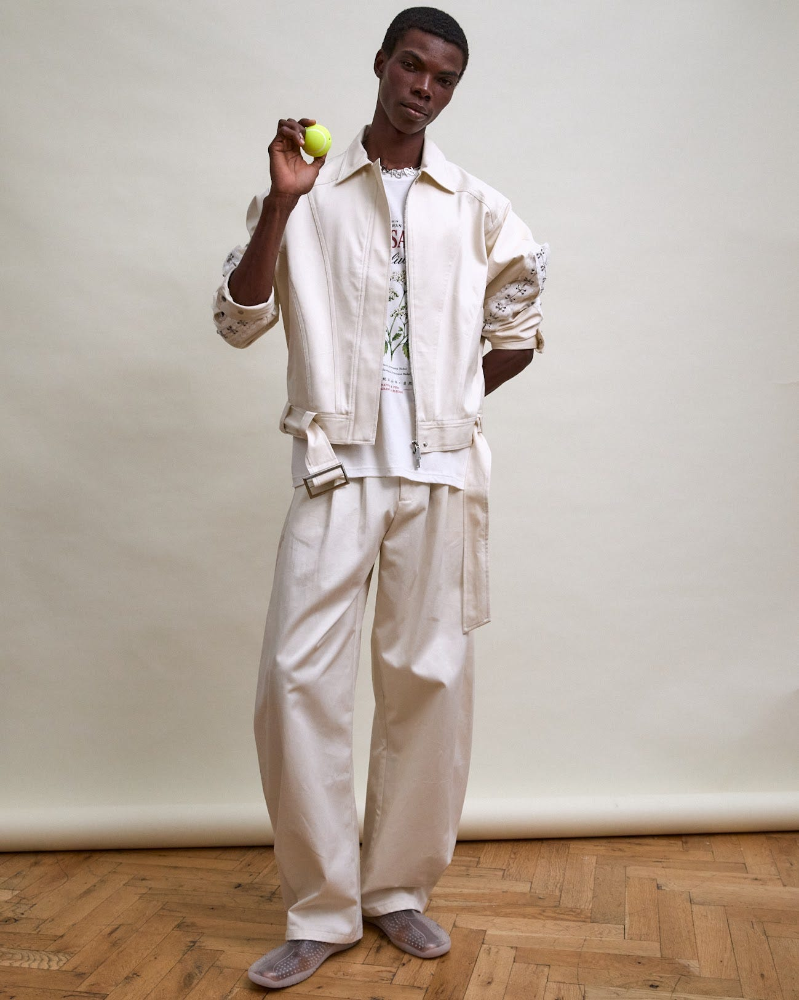
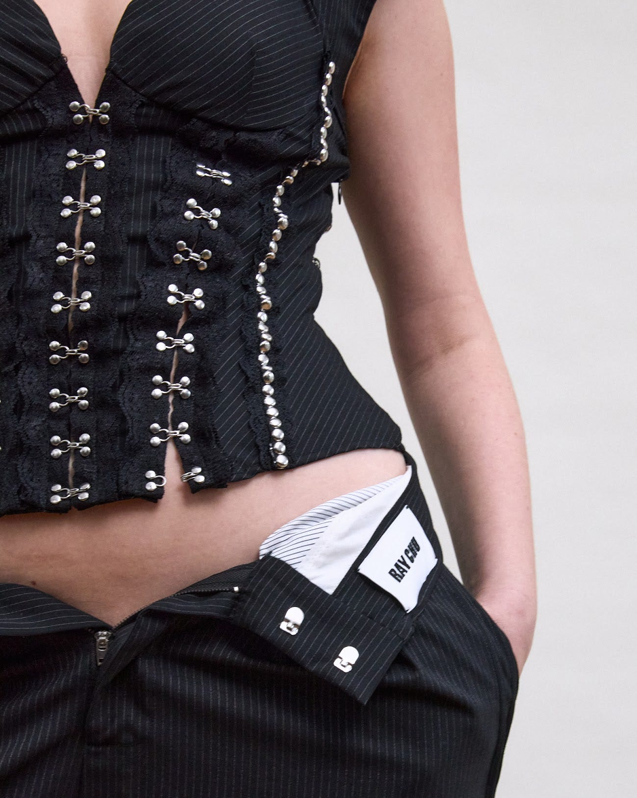
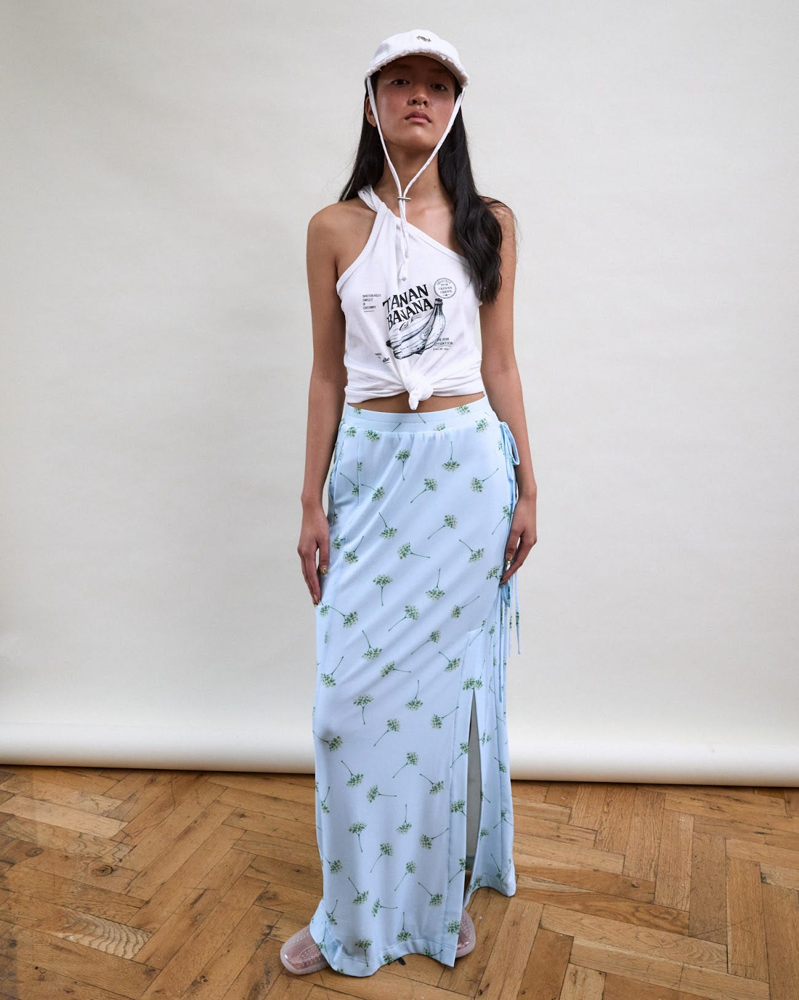

import { Image } from "#lib/elements";
import { SideBySide } from "#lib/assets/blog";

import _003 from "./003.jpg";
import _004 from "./004.jpg";

I was on the 'Fans Only Club' list for Ray Chu SS27 at this year's London Fashion Week and I'm about to give you the rundown! Once in line with photographer @josh.b.photos, I immediately liked what I saw; the clientele were boujee and the venue was homely. I felt as if I'd been invited to a fashionable dinner party at a friend's apartment in Islington. On entering, I spotted Ray Chu dressed in denim casually among the crowd exuding host energy - and what a treat I had in store.

Copied from my notebook: The presentation format feels very raw and authentic. I love Ray Chu's playful direction in which the models are free to roam and interact with fruit products (but remember this is not a lemon!)

Chu's fruit-inspired, citrusy props were actually selected from the Hello Nancy brand - a cheeky sponsor of the collection intended to emphasise the designer's sensual and fun approach to fashion.

The setup really allowed me to capture every single detail of the clothing on display, drifting away from catwalk territory, where the stage feels like a motorway. The idea of the presentation is to refuse being over in the blink of an eye; I was able to ask questions and bask in the splendid designs.

My first question was: How does one get to be in the 'Fans Only Club'? Chu tells me it's an open invite, designed to feel safe and accessible where people can grow in empowerment and confidence. This comes off the back of reported attacks towards the LGBTQ community in the news so I gathered that the clothing is made to fight back.

Androgyny features throughout the collection - where deep v-neck corsets detailed with swing hooks meet unzipped black pinstripe suit trousers. It's a pairing which asks us not to put a label on it - anyone can choose what gender they'd like to play and be free in what they wear.

Although the collection does border on workwear, I wanted to get to know the overall occasion. It seemed to escape the daily 9-5 and instead identify with the beach and I was getting a lot of island motifs. Chu explains that the collection spans daywear to eveningwear - in the early pm hours it's for lying on sand and dipping your feet in water, but it also knows how to do a formal dress code.

So, what makes London Fashion Week special for an international designer like Chu, with his global status spanning cities and islands? I was pleased to hear that the UK capital's spin on Fashion Week has a welcoming approach to its worldwide network of designers, so it's a warm and inviting space. Out of all the places with which Chu is associated, he tells me that Taiwan remains the one that stimulates his creativity most.

This look from the collection encapsulates that slow life by the sea aesthetic with its midriff top and chin strap sun hat. The floral, blue, satin maxi skirt is perfect for slipping into after a fun-filled day of island activities for some sunset drinks. The way in which the white graphic top is constructed, with its asymmetrical tie detail, creates a draped effect like a toga. It screams extreme heat. Even the footwear is well-versed in 'aquatic' and is designed to withstand the waves through its rubber texture.

You'll want to pack this one in your suitcase for your next vacay abroad. With Chu, you can squeeze water activities and rooftop sky bars into the itinerary, there's an outfit for whatever the motive!

Collection highlights:

<SideBySide>
	<Image src={_003} />
	<Image src={_004} />
</SideBySide>

Photography by Emanuele Moi
