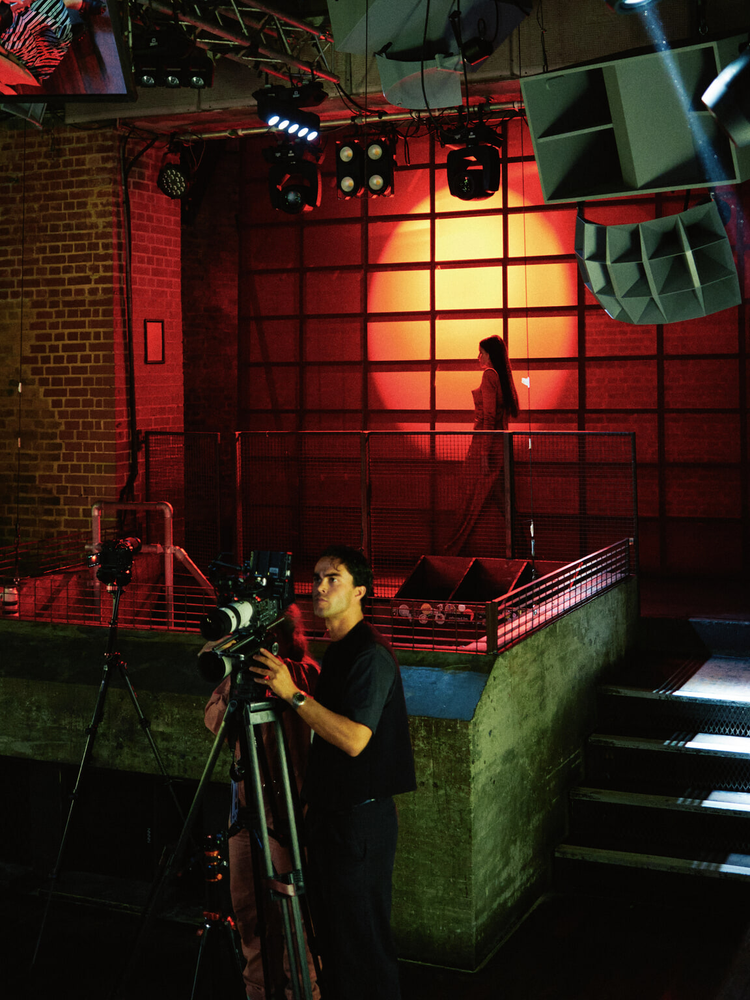
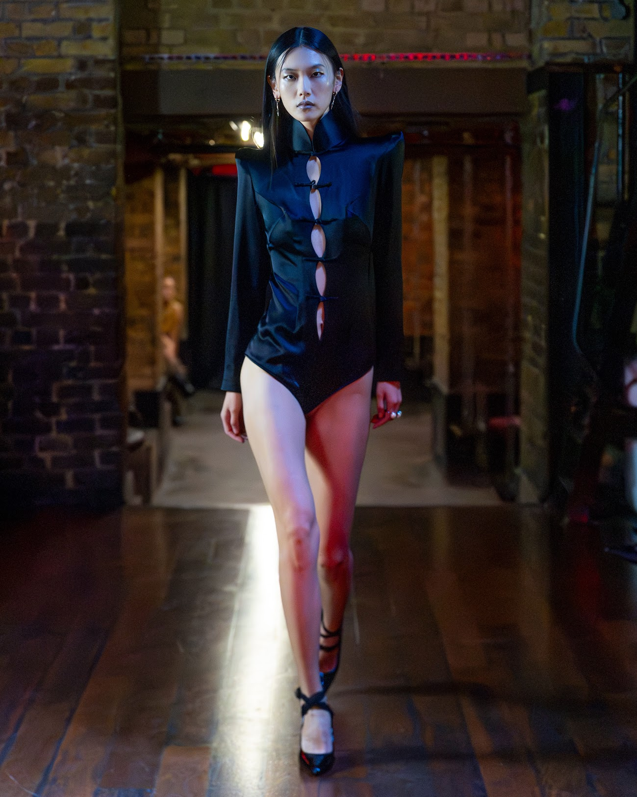
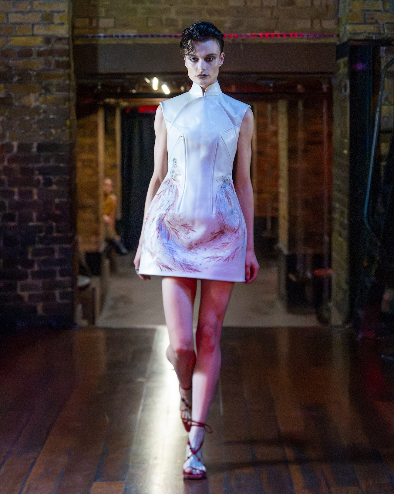
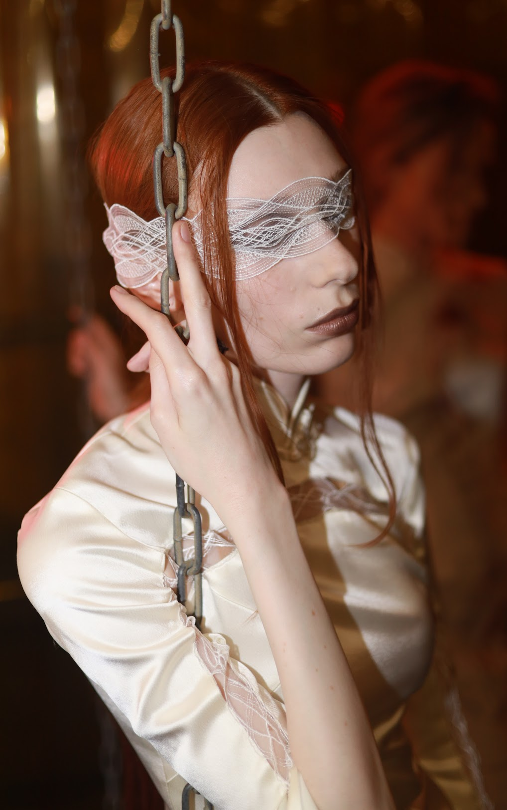

import { Image } from "#lib/elements";
import { SideBySide, Annotation } from "#lib/assets/blog";

import _005 from "./005.jpg";
import _006 from "./006.jpg";
import _007 from "./007.jpg";
import _008 from "./008.jpg";

I love a bit of Jenn Lee at Fashion Week! This year marks my second visit and it was a hot, steamy production - as per! I entered the chamber set in Farringdon’s Fabric London, renowned for its partying all night and (in this case) day. Instead of formally taking an allocated seat on the row reserved for press, I was directed to an elevated dancefloor from which I’d watch the show standing, where I’m sure people made bad decisions the previous night. The nightlife design of the venue really raised the roof and dialled up the energy of the show.

<Annotation>
	@josh.b.photos
</Annotation>

Avant-garde is at the very core of Jenn Lee through the collection’s deconstructed approach. The costume details play such a role, we’re not just looking at a silhouette but rows of braided cord used to stitch the dress together. It’s conceptual. It’s art. Jenn Lee shows us what happens when you take a piece of red silk, which embodies flesh, and experiment with classical tailoring methods to push boundaries and make a statement.

On to the standout of the collection: It was a collaboration between gothic and ballerina. The heel straps tie in a cross up the ankle like a satin pair of pointe shoes and the silk, black bodysuit fits like a leotard. It’s a look that wants to reveal, with its vertical cut-outs, but can’t help but suggest tension through its raised shoulders and high, dracula-like collar.

The high heel has a moment in this. Pointed stilettos reign. I wanted them all. My favourite was a black patent pair with a lace strap - there is definitely a lace motif going on in this collection and it makes it all the sexier.

Jenn’s moodboard is all sculpture - bodices with their own unique stamp of piping and iterations of the Taiwanese qipao. The clothing contours the body. There are a lot of high collars and sharp gothic lines - it reads like an Angela Carter book, bursting at the seams with repressed desire.

There’s a special collaboration involved here with a 75-year-old Taiwanese master artisan, and Lee refuses to let this go unnoticed. With the collection’s high volume of artisanal and decorative methods comes an exhibition - and those with tickets to the show get free entry. The rolling credits of runway transpire, at which point Lee parades down the stage to Lust for Life by Iggy Pop followed by her models. We are invited to join them in the next chamber, up close and personal, to really learn about the designer’s world and study the craftsmanship.

Classic is contemporised through the architectural elements; the fashion is propped up against brick walls and illuminated by red LED lamps to bring that harsh, nightclub ambience. The metal chains speak like the designs, in the language of bondage, where emotion is given no escape route. Lee translates this into one of her looks through the use of a lace eye mask; the female form is adorned like a gift-wrapped present, its inner feelings under one large spectacle of disguise.

Fashion Week can at times feel too neat and polished. We’re attending grand Art Deco buildings stationed between Holborn and Covent Garden and glimpsing at timeless tweed and opulent jewels. My advice to you is to look at what’s going on underground, in the spaces that are used to pulsing with drum and bass, techno and dubstep. They introduce a cool, gritty and alt spin on the city’s week of fashion and I’m so here for it!

A gallery from my perspective shot by Joshua Bibby:

<SideBySide>
	<Image src={_005} />
	<Image src={_006} />
</SideBySide>

<SideBySide>
	<Image src={_007} />
	<Image src={_008} />
</SideBySide>

Photography credits:

- Maja Smiejkowska @msmiejkowska
- Prinae @washingtonp0st
- Adam @adam_pietraszewski
- Miriam @miriam_brailsford
- Hebi @hebikawaaa
- Becca @beasphotoss
- Sophie @sophienoellepixel
