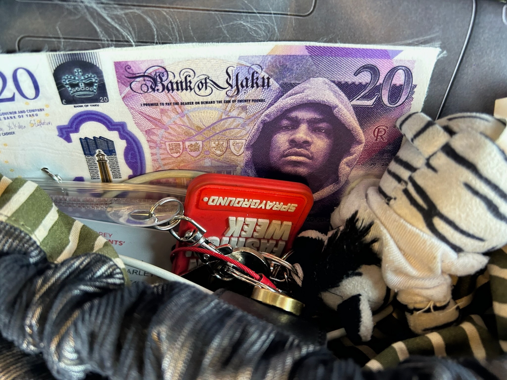
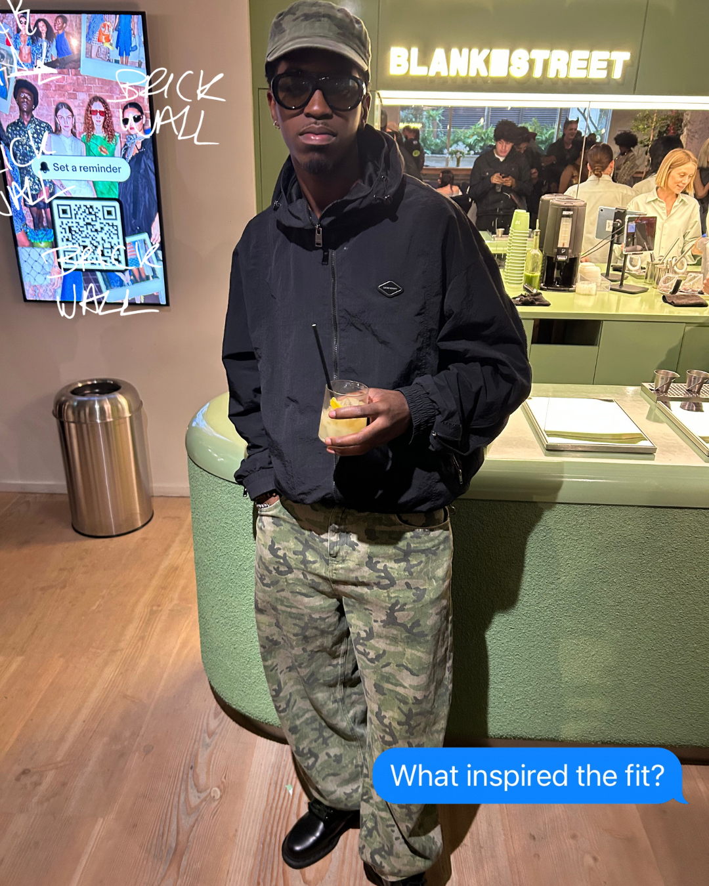
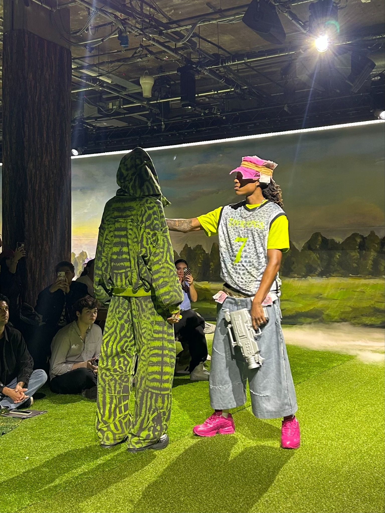
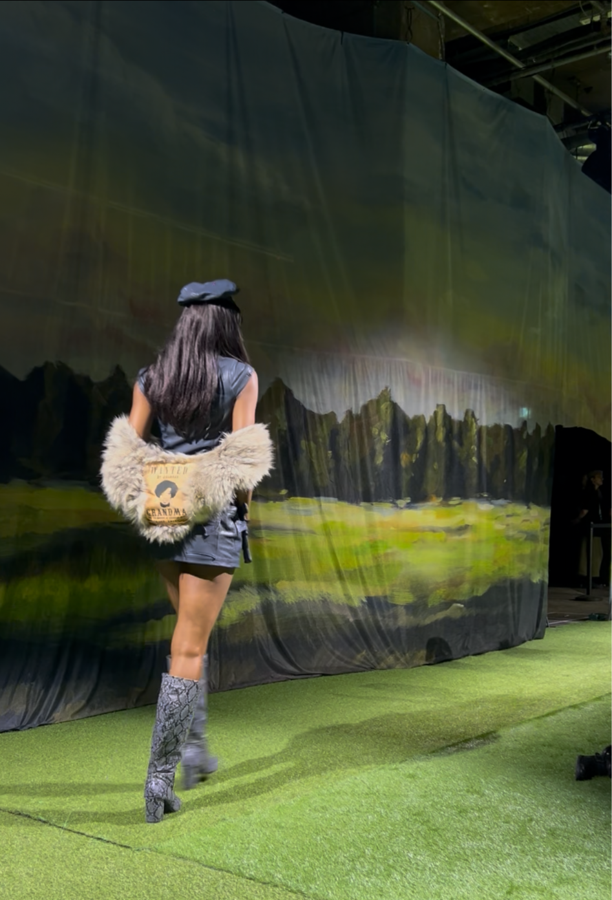
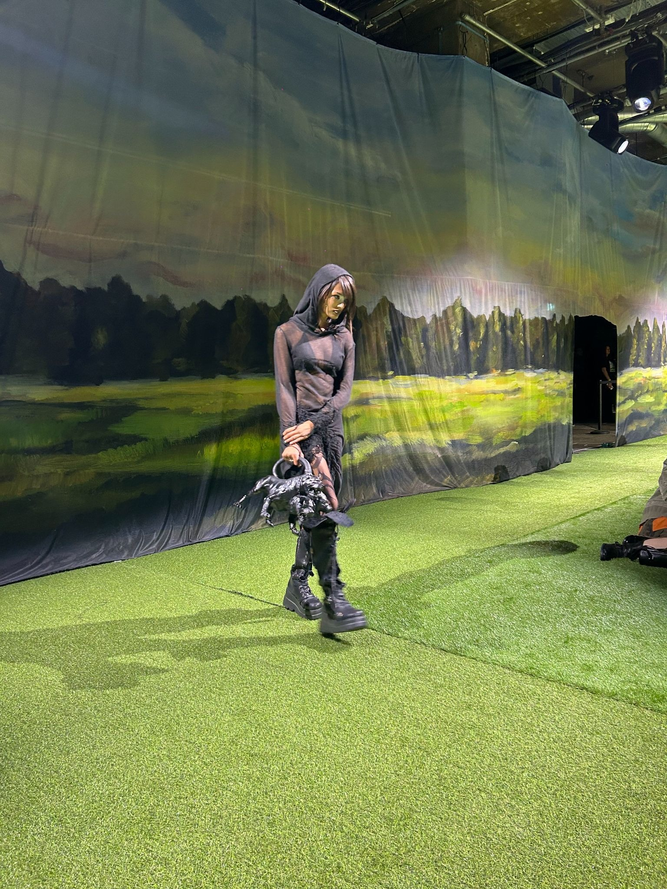

import { Annotation } from "#lib/assets/blog";

I set my alarm for the Yaku show this morning and had to be there for 12pm. Fashion week teaches you about so many emerging designers, big and small. This particular one has blown up recently and it might be my LOTY (label of the year).

<Annotation>
	From our inbox
</Annotation>

The graphics on the invite spoke volumes about the creativity behind the brand, it was just as cool as a Freddie Gibbs album cover (shoutout @charlizepfister). Family BBQ was the concept; a reunion of all the family members. There’s food on the grill, unc teaching his nephew the lore of self-defence and grandad leading story time with the tales of his younger days. Plus a whole other cast of characters, who are likely to be series regulars within our own lives. There’s something there to connect with for everyone, the collection breathes real life.

In fact, this familial theme translates into my entire experience of the show. I have so many cool people to thank for exchanging their life stories and collaborating on Brick Wall…

<Annotation>
	From our Instagram series ‘What inspired the fit?’
</Annotation>

Connection seems to be the collection’s objective and the lounge at 180 Studios provided the perfect space for meeting people. Within 1 hour I’d met a Youtuber, photographer, model, two fashion designers, music producer and a DJ. Like Yaku’s character archetypes, I had formed my own.

The clothes felt personal. I found a recurring feature to be footwear, different versions of Nike Air Max 95s, some solid neon pink and others slate grey - these were sick. The collection really asks you to consider “what would this family member wear to the BBQ?” - for the teen girl into her training, this would obviously be some high top, red boxing boots. While for the military man, a sturdy pair of timb-style boots with folded over flaps were sure to make the cut - Nike socks peeking through of course.

The show got you saying ‘cheeee’ as the overall composition of each look ate. Take the one below; it’s so slick with its knee-high snakeskin boots and matte, blue-grey, zip-up pinafore which matches the sideways beret. I love how Yaku codes a look with a piece of that specific character, if you look carefully you learn from the fur bolero that this woman is ‘wanted’ - I wonder what for?

Yaku throws shapes (literally). A practical carry-on, mini duffle becomes a bulldog, think Spike in *Ben & Jerry*. A shield takes the form of an iPod mini and everything is layered to the absolute max. Caps are stacked on top of heads and hung on shoulders to create a padded effect. Yaku maximises his Spring Summer collection and gives us plenty to look at.

I was able to interview Yaku after the show and get the scoop, firstly on those banknotes we were given on being seated…on mine was Skepta and Erini, sat next to me, had fifty pounds worth of D Double E. Yaku shouted Tibo, the ‘swag artist’ behind it all, who created this concept; the idea was to dish out tokens of the British grime scene and salute the legends.

I was able to feature Yaku on our ‘what inspired the fit?’ series and in a nutshell he described his fit as “awake 24hrs. Same drip”. He refuses to wear clothes “on purpose” and labels them instead “real dust from the studio”.

All the crew were on brand with the CANT RUSH COOKED FOOD tee which formed a special community and really spotlighted each creative behind the production. Yaku brought that designer drip through his accessories. Through the belt loops of his low-waisted, baggy, black trousers was what looked like a braided belt, woven with threads of yellow, red, green and black. His head was the busiest with some customised Namco light gun glasses, inspired by the collection, perched on top of a black baseball cap lined with a fur mohawk and black durag underneath. He really understood the importance of headwear.

I was interested to know Yaku’s first introduction to fashion, he’s certainly a natural but I wanted in on the creative muse behind it all. The answer was Samuel Ross at Cold Wall. His friend Dio put him on and this led to a connection with the British designer. From there came T-shirts and then the Yaku label happened. I felt so honoured to see it irl and it was a real end-of-fashion-week high. This is a brand I will stay with and I look forward to the next family BBQ - I wonder what will be served on the plate then?
