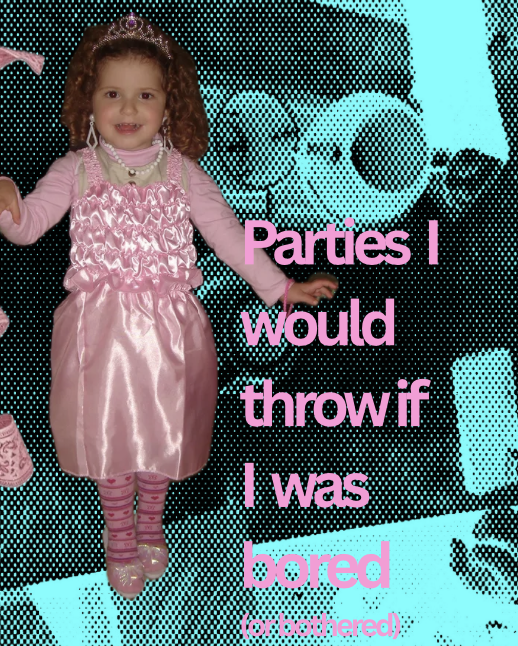
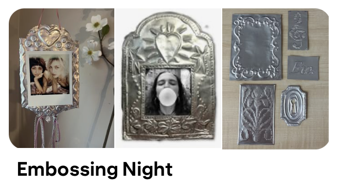
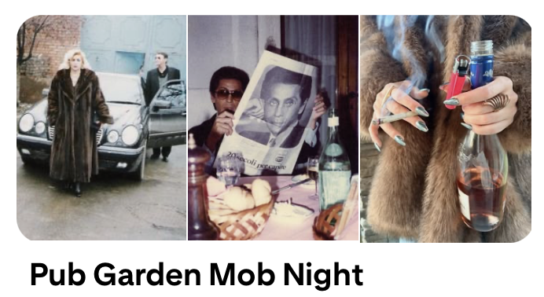
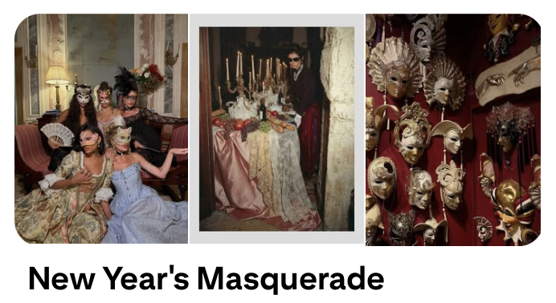
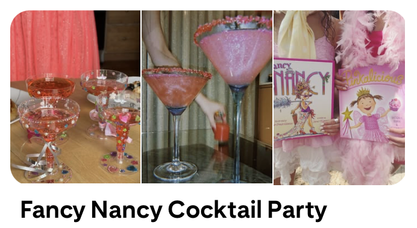
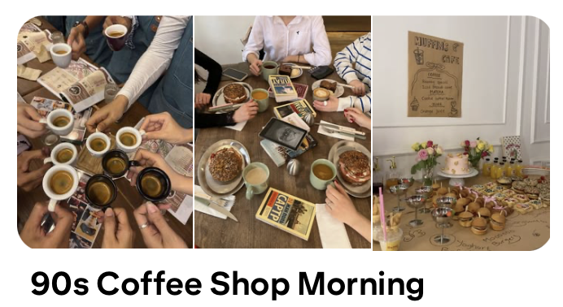
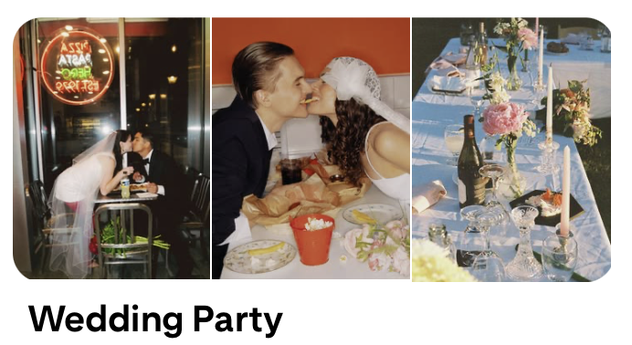
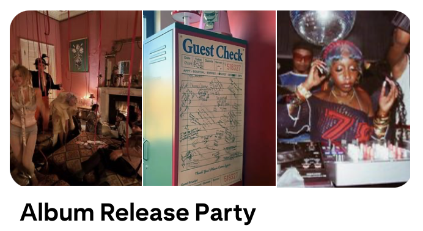

After a month of fashion writing, I’m feeling a bit out of words so my solution is to have a bit more fun with this piece so I want to share some cool party ideas. Not sure I understand the meaning of party - maybe gathering is a better word but life is too short to live on technicalities. So here’s a list of themed parties I would throw if I had the joy of living in the same city as all my friends - I thought I might as well document it to keep as inspiration and to lend these ideas out for all of you until I find the opportunity.

For me, a good morning or evening is always spent making crafts so I’ve always loved the idea of making ‘parties’ out of it and finding different ways of having fun, so a lot of these are based on that. For each party I’ve added a pinterest board for you to get the full idea, so they’re all available on the link at the end of the article if you wish to find out more.

## 1. A Frame Embossing Night

1. The theme is silver chrome, so glittery eyeshadows and ties should all be on show.
2. We’re gonna emboss foil frames, super easy tutorials available everywhere, and create a valuable piece of memorabilia.
3. Have an instant camera to take photos of the night and people can keep in their frames.

## 2. Pub Garden Mob Night

1. Get everyone round to your favourite pub one night but the dress code is a mob party.
2. There’s just something about being dressed up, mysterious, and in a large group, that feels so fun about a night out and if you love going to the pub sometimes the best night outs are already in your range - just add a twist.

## 3. New Year’s Masquerade

1. Make people bring pages of inspiration, words that they love, handwritten pieces etc. and turn them into papier-mâché masks - you’re quite literally facing all your dreams for the year.
2. Stage the masquerade as formal wear, candles everywhere and put on a classic disco playlist - Marie Antoinette (2006) style.

## 4. Fancy Nancy Tutus Cocktail Party

1. In memory of our 2000s childhood diva, Fancy Nancy, throw a birthday party as fancy as possible, tutus and tiaras included and invite everyone for a fancy cocktail. Bonus if you make crowns there.
2. In honor of the diva, you need all the cocktail essentials from tiny umbrellas, pink glasses and slices of fruit to keep on the rim.

## 5. Yoga Morning

1. Personally I would hate this, but sometimes it’s just not about what you want - but what you know would be fun if you did it with your friends.
2. As long as no one takes themselves too seriously it could be a cute morning of genuine relaxation and interesting chats - not to mention the chance of putting together a fun workout outfit and finish off with a good lunch.

## 6. 90s Coffee Shop Morning

1. Everyone has to bring a magazine to read and baked bites for everyone. Especially perfect for the change to cooler weather when you’re after a cosy morning with your friends.
2. Have on classic soundtracks from 90s movies just to complete the atmosphere.

## 7. Wedding Party

1. Fake marry your friends and stage it as a casual, chaotic wedding.
2. Go to the park and set up a cute outdoor gathering space and perform the ceremony.
3. Have each person bring a single flower and combine to create a unique bouquet for the day.
4. End with a casual burger outing, NYC style. Unfortunately my inspiration for this was Lily Allen’s wedding to David Harbour which is why it needs to be done super kitsch and ironic.

## 8. Art Deco Dinner

1. Get everyone in 20s attire for a dimly lit, red themed dinner.
2. Real 1920s recipes sound unappetizing so go with your gut and make a meal that everyone can appreciate and enjoy - the last thing anyone needs is to turn up hungry to a dinner of ham & pineapple jelly.
3. End the meal with a cigarette offering and in true prohibition style, drink as if there’s no tomorrow.

## 9. Album Release Party

1. If you and your friends love the same artist(S) why not throw a party the night it releases instead of listening to it alone in your room and writing a lengthy review no one will read. If you really want to bother people with your music opinions it has to be live!!!
2. Jokes aside, stage it as a real release party and get everyone to dress as their favourite artist.
3. Have a paper board up and let people write a review or rating and see what everyone has to say.

Have fun party planning..
