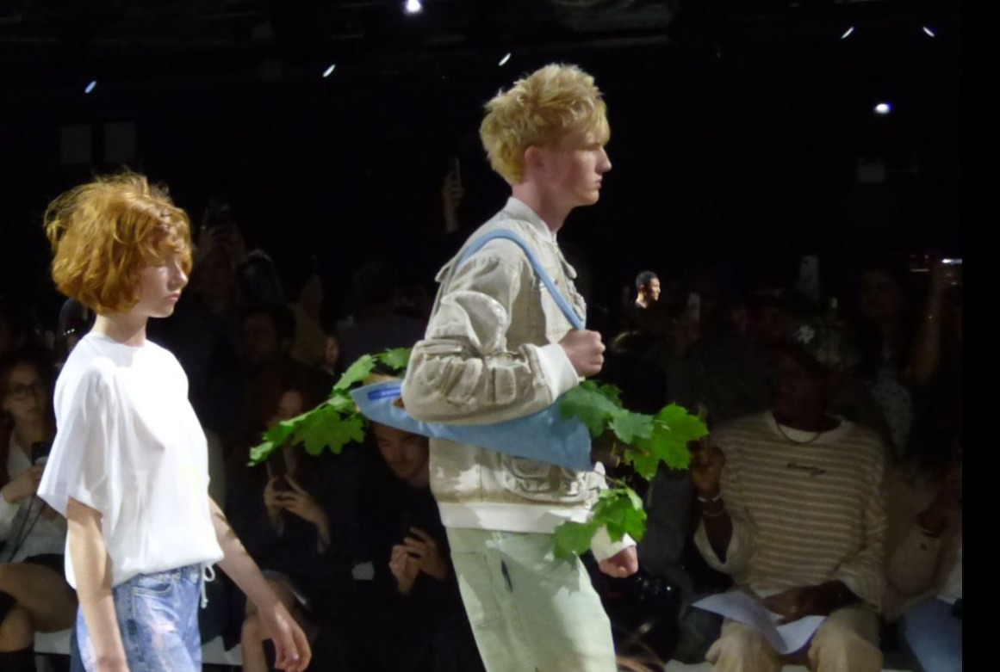
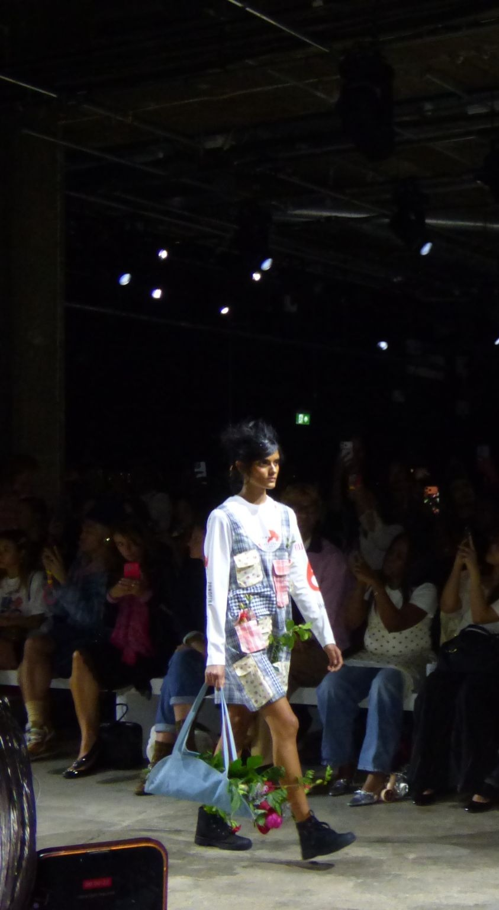
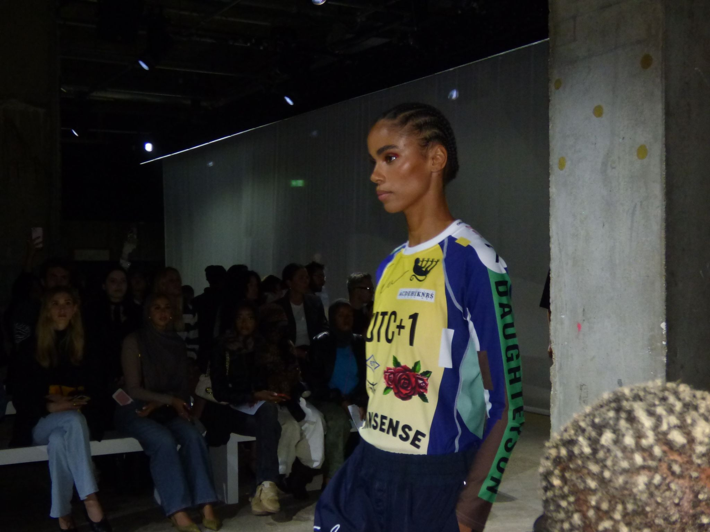
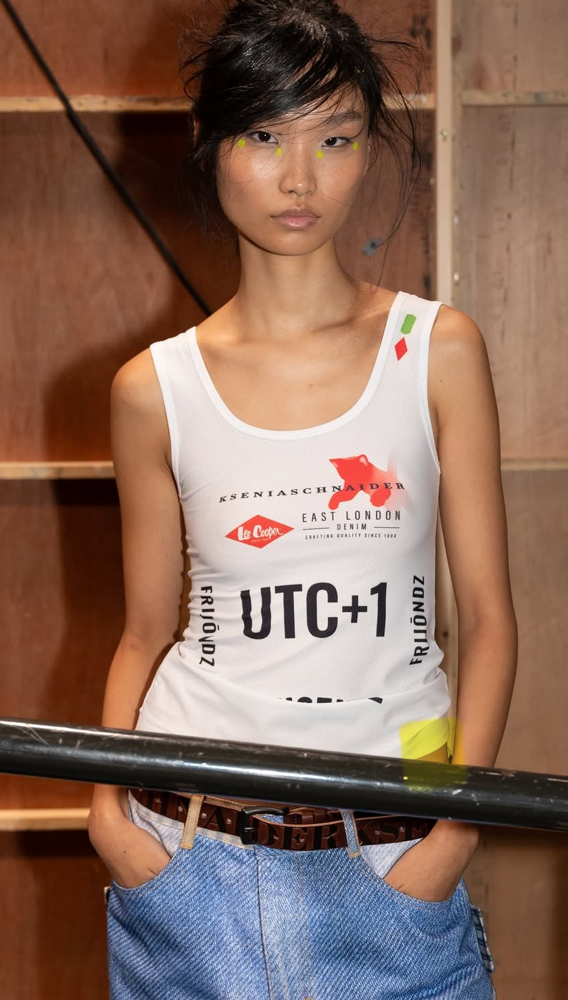
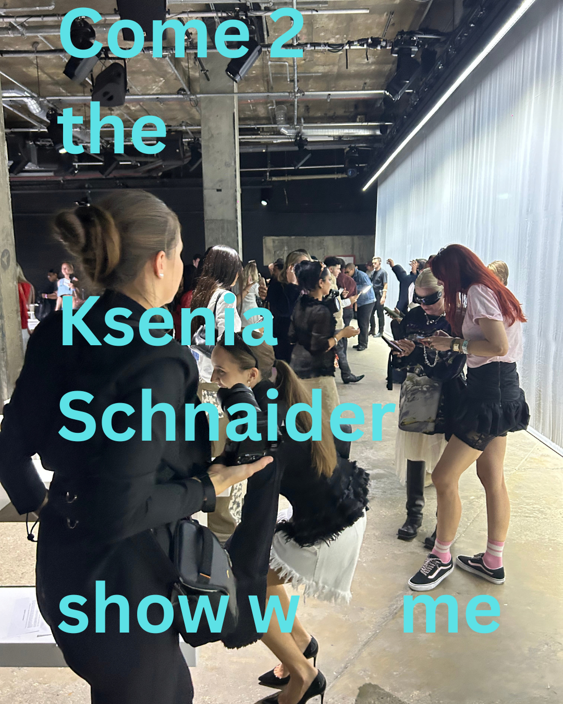

import { Annotation } from "#lib/assets/blog";

Welcome to KSENIASCHNAIDER, where garments are designed to move through life with you. The UTC+1 collection focuses on the flaneur's POV, showing how clothing supports one's everyday performance. Work boots and mini duffle bags feature throughout - they're there to help get the job done.

To ask a KS model the question: 'What's in your bag?' would receive the response: a bunch of leeks. Fashion transcends 'flashy' and 'look-at-me' and leans instead into utility. The show is supposed to feel like watching people run their errands, whether they are picking vegetables or arranging bouquets. Every part of the look is fitted with a function.

Denim becomes the potting soil for daffodils, the upcycled shoe becomes a vase for the flowering plant; dainty red petals against all-black leather. Both are unusual combinations but this is exactly what the collection proposes, fashion meets practical.

The title of the collection refers to a time zone which takes place out of the equation. It's not limited to one space - one can belong anywhere. The collection refuses to affiliate. The white, square neck tank is a bulletin board of different logos. Some are extra bold, some carry an identity: Lee Cooper, and others are small, italic and understated.

There was a real variety on the Ksenia Schnaider plate; nothing is quite as it seems and everything is missing its counterpart. We get swimwear but no sea, jerseys but no ball in sight. Visual codes, belonging to a variety of sources, amalgamate to create the KS universe. The clash of elements is foreign to the average human, the clothes try to speak in our language 'DAUGHTERSON' but what exactly does that translate to? The front of the top reveals the answer - nonsense.

Within this fictional community, borrowed elements and identity markers from all different sources merge to create all different visions. There's no set dress code! Baggy is in for those wanting a relaxed, slouchy denim pant look. The upper half is often kept free, the long sleeve jersey hangs loosely on the arms. The uniform comes in all different shapes and sizes; it's not a one-size-fits-all, the sleeve is a space for expression.

Brick Wall's highlights include hair and cosmetics: messy buns have a windswept look with strands flying everywhere. This detail matches the designer's statement about functional fashion - the hairdo must be sacrificed in order to get the work done! The makeup is kept minimal but carries an otherworldliness, with the pops of neon dotted under each eye.

<Annotation>
	"UTC+1" backstage moments by Aimee Chansue, Jenny Li, Maria Salinonova, Matthew Didych, Sacha Williams, Taardii, Yana Kasa 📸
</Annotation>

On Thursday night, 180 Studios, stationed in Central London's Strand, introduced us to a highly mobile, practical and sustainable way of dressing up. Clothing mimics a postcard, stamped with fragments of collected places and identities. However, these codes do not define, in the UTC+1 time zone one exists and belongs everywhere.

<Annotation>
	Check out our post on @brickwallzine for some extra content
</Annotation>
