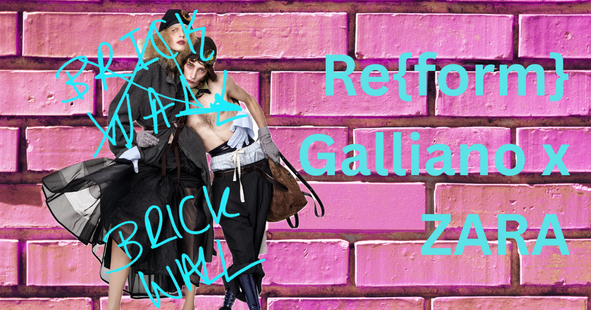

import { Annotation } from "#lib/assets/blog";

<Annotation>
	Snippet from Re\{form\} by John Galliano x Zara. Photography by Steven Meisel. September 2026.
</Annotation>

On my flight back to the UK, I decided to pick up a copy of Vogue Greece to read on the plane. With my sleeping mask propped on my head I was preparing to fall asleep - instead something worse happened - I stumbled across an interview with Marta Ortega Perez. Perez is daughter of Spanish billionaire Amancio Ortega and subsequently destined to be Chair of Inditex, the company behind Zara, Bershka, Pull & Bear, Massimo Dutti, Stradivarius, Oysho and new brand, Lefties. As the family behind the world’s leading fast fashion brands, they are not known to give interviews, which is why Vogue got a seemingly golden opportunity to have a real talk with Perez. Underwhelmingly and unsurprisingly, rather than analyzing the Galliano x Zara collaboration with skepticism as all fashion critics anticipate, the interview was bland and uninsightful and glamorised one of fashion’s worst collaborations to date.

As many fans of fashion, I too was disappointed at the cancellation of the John Galliano Met Gala, considering last year’s Met was hosted by a billionaire, I was unaware that Vogue had any moral fibre left. John Galliano, whose career has transcended to impact the history of fashion, is known for excellent tailoring and structure throughout designs embedded with romanticism, gothicism, and eclectic theatricals. As the man behind Carrie Bradshaw’s newspaper dress, the infamous Dior saddle bag, and the Maison Margiela SS24 moment, it is without doubt that he has curated some of fashion’s favourite designs. And in many ways - who wouldn’t want a chance to wear Galliano.

Zara is accessible to everyone, located globally, and affordable for the most part. Therefore having a major working class brand like Zara collaborate with Galliano feels as though the fashion industry is improving its accessibility and becoming what it’s truly meant to be - for the people. If this was the way the collaboration had been curated it would be safe to call it a success - however there is no way to justify its reality.

Zara is notoriously not for the people, creating unethical working conditions, polluting our planet as part of the world’s third largest polluting industry and manipulating a generation into overconsumption and love for fast fashion. Its sister brands are no different. The Galliano collaboration is not meant to be accessible as per its current consumers but rather meant to upscale the brand into one more ‘high fashion.’ Therefore, signing Galliano on for two years is meant to represent an archival reworking for Zara, when in reality it’s meant to justify their fast fashion business model as a credible high fashion brand.

In [Gaby Wood’s interview with Marta Ortega Perez in British Vogue](https://www.vogue.co.uk/article/marta-ortega-perez-interview), Wood reports how “Galliano, who calls his two-year project for Zara a “reauthoring” of garments from its archive, admits that his initial reaction, when Marta asked if he might work with Zara, was, “No way.”” Understandably, you would never expect a fashion icon such as Galliano to consider designing for a brand that follows short trend cycles and has no defined style of its own. Wood continues to explain how after a tour of the Inditex headquarters Galliano, apparently impressed, changes his mind and agrees to a two year contract. I wonder if he had perhaps toured one of Zara’s sweatshops, such as [the infamous ‘slave conditions’ of a warehouse in Brazil](https://cleanclothes.org/fashions-problems/issues-old/migrants-in-depth/stories/slave-like-conditions-at-zara-supplier), if his instincts would have remained intact?

The branding of this collaboration as a revival of old stock and Zara archive, while seems intuitive to an age of second hand fabric importance, does not eliminate the continuation of [Inditex’s production](https://www.businessoffashion.com/articles/sustainability/inditex-agile-fashion-force/) of over a billion individual garments a year. Garments which are soon replaced by the next internet micro-trend or face the inevitable wear and tear of poorly constructed pieces. Not to mention, the everlasting impacts of Inditex’s fabrics of choice, from polyester to polyamide, linger in our oceans and landfill, breaking down into microplastics that cannot biodegrade. Haute-couture, the fashion Galliano is used to creating, is personalised, timeless and built with expertise that allow them to last as true archive pieces. Zara can try to claim such heritage in its archive, but they will have to dig deep into global wastelands to find them.

Ultimately, the Galliano x Zara Re\{form\} is in motion, with Volume 1 being presented earlier this month. Within the collection, Galliano is inspired by post-Revolution France, giving way to dandyism and gothic, regal Ready-to-Wear that I don’t believe the average Zara consumer is looking to wear. On the [zara.com](https://zara.com/) website, it is quoted “You have to look twice sometimes. It’s a dialogue.” and a dialogue it definitely is - with pieces prices up to 700.00 GBP, Zara is creating a unique space in the market but is bringing Galliano’s name down with it.

It is unfortunately not the first time the word Reform has been used to represent an idea so incredibly counteractive - who would have thought John Galliano and Nigel Farage have so much in common.

Sources:

- [https://cleanclothes.org/fashions-problems/issues-old/migrants-in-depth/stories/slave-like-conditions-at-zara-supplier](https://cleanclothes.org/fashions-problems/issues-old/migrants-in-depth/stories/slave-like-conditions-at-zara-supplier)
- [https://www.vogue.co.uk/article/marta-ortega-perez-interview](https://www.vogue.co.uk/article/marta-ortega-perez-interview)
- [https://www.businessoffashion.com/articles/sustainability/inditex-agile-fashion-force/](https://www.businessoffashion.com/articles/sustainability/inditex-agile-fashion-force/)
- [https://www.zara.com/uk/en/woman-reform-campaign-l19848.html?v1=2759928](https://www.zara.com/uk/en/woman-reform-campaign-l19848.html?v1=2759928)
