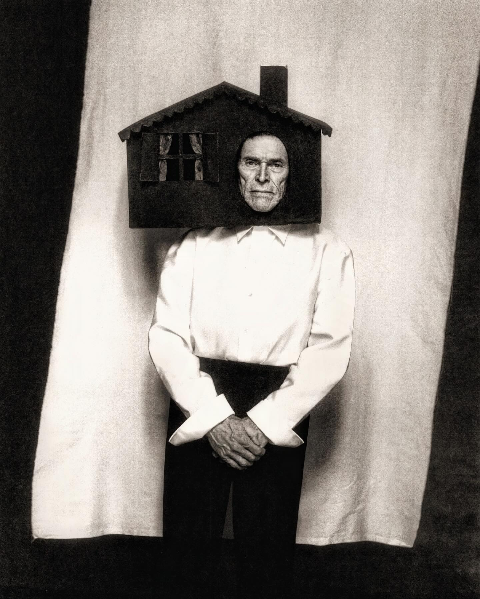

import { Image } from "#lib/elements";
import { SideBySide, Annotation } from "#lib/assets/blog";

import _1_1 from "./1_1.jpg";
import _1_2 from "./1_2.jpg";
import _1_3 from "./1_3.jpg";
import _2_1 from "./2_1.jpeg";
import _2_2 from "./2_2.jpg";
import _2_3 from "./2_3.jpg";
import _3_1 from "./3_1.jpg";
import _3_2 from "./3_2.jpg";
import _3_3 from "./3_3.jpg";
import _5_1 from "./5_1.jpg";
import _5_2 from "./5_2.jpg";
import _5_3 from "./5_3.jpg";
import _6_1 from "./6_1.jpg";
import _6_2 from "./6_2.jpg";
import _7_1 from "./7_1.jpg";
import _7_2 from "./7_2.jpg";
import _7_3 from "./7_3.jpg";
import _8_1 from "./8_1.jpg";
import _8_2 from "./8_2.jpg";
import _9_1 from "./9_1.jpg";
import _9_2 from "./9_2.jpg";

For many, Halloween becomes a time of overconsumption and overcompensation - but I believe the best costumes are the ones you can diy. Furthermore, I don’t believe in having to be scary for Halloween, although a lot of people have strong stance against fun costumes, it is a night that is way past tradition and more about embracing your own interests.

Now, one thing I hate is a bought costume - I honestly have never seen the need for it when all you need is to be crafty with the clothes and materials you already own. So let me dive into some ways you can make a clever last minute costume and still stand out. In a time where the hungry caterpillar and princess and the pea have been compromised, we need to start diving into the truly niche.

## 1. Paper Doll

<SideBySide columns={3} stack={false} gap="0.5rem">
	<Image src={_1_1} style="object-fit: cover;" />
	<Image src={_1_2} style="object-fit: cover;" />
	<Image src={_1_3} style="object-fit: cover;" />
</SideBySide>

By far my favourite, the paper doll is an easy, fun take on the ‘making my dream item’ trend. The customisable quality is also super important because it means no two people can ever have the same look. All you need is some strong card, draw and colour in your designs, cut them out and stick them onto your outfit underneath. You can get so creative with a costume like this and make it true to yourself, your accessories and your style. If I were to do this, I would definitely incorporate a cut out coffee in my hand and a paper feather boa.

## 2. Trench Coat Dealer

<SideBySide columns={3} stack={false} gap="0.5rem">
	<Image src={_2_1} style="object-fit: cover;" />
	<Image src={_2_2} style="object-fit: cover;" />
	<Image src={_2_3} style="object-fit: cover;" />
</SideBySide>

Perfect for those who want to keep it lowkey and wrap up in a long, autumnal coat. The trench coat dealer idea lets you incorporate whatever you want under your coat with a simple pin or double sided tape. A clever way to share treats throughout the night or show off your secret collection of things. For me, I would love to pair this with shades, knee high boots and unveil a collection of SATC DVDs.

## 3. Thieving Magpie

<SideBySide columns={3} stack={false} gap="0.5rem">
	<Image src={_3_1} style="object-fit: cover;" />
	<Image src={_3_2} style="object-fit: cover;" />
	<Image src={_3_3} style="object-fit: cover;" />
</SideBySide>

Forget feathers and black, gothic dresses, this Magpie outfit is all about the hidden gems and accessories, just like those collected by a Magpie. Gather all your shiny and silver jewellery, lipsticks and crystals and sew them into your tights to secure them in place. I’ve seen this done a few times and I absolutely love it, it’s so underrated and so easy to put together.

## 4. That 1 Picture of Willem Dafoe

<Annotation>
	Willem Dafoe, Photographed by <a href="https://www.instagram.com/SzilveszterMako/?hl=en">Szilveszter Mako</a>, for @GQItalia Man of the Year, December 2023.
</Annotation>

The classic ‘life imitates art’ costume, this photograph of Willem Dafoe is the most recognisable photo I can think of, while keeping a cool, surrealist twist on a celebrity impersonation. Ultimately, like the Paper Doll look, you can easily make a similar house out of card and hold it on all night using an elastic around your head. Couldn’t be easier or more iconic.

## 5. Lampshade

<SideBySide columns={3} stack={false} gap="0.5rem">
	<Image src={_5_1} style="object-fit: cover;" />
	<Image src={_5_2} style="object-fit: cover;" />
	<Image src={_5_3} style="object-fit: cover;" />
</SideBySide>

So cute if you love vintage shopping and houseware, a lampshade is so unique, fun and easy to plan for Halloween. Paired with colourful tights, a vintage dress and a fun beaded bag, you can be the ultimate vintage shop find. Even if you cannot come across a beautifully embellished lampshade you can always decorate a simple one or a shaped piece of cardboard to fit your interior design dreams.

## 6. Bouquet of Flowers

<SideBySide columns={2} stack={false} gap="0.5rem">
	<Image src={_6_1} style="object-fit: cover;" />
	<Image src={_6_2} style="object-fit: cover;" />
</SideBySide>

A favourite for those who love putting a bouquet together and keeping their outfits fresh and floral, this is honestly one of the cutest costumes I can think of. Not only can you pick all your favourite colours and match them with your favourite outfit underneath, but you can pick the perfect ribbon to tie it altogether. Not to mention you can hand flowers out and still keep them in the house after the end of the night.

## 7. Dalmatian

<SideBySide columns={3} stack={false} gap="0.5rem">
	<Image src={_7_1} style="object-fit: cover;" />
	<Image src={_7_2} style="object-fit: cover;" />
	<Image src={_7_3} style="object-fit: cover;" />
</SideBySide>

One of my costumes last year, it’s honestly so easy to do and very unique for an animal themed idea. In a year of Olivia Dean polka dots I can guarantee everyone has at least one piece to be able to complete this outfit and to finish off you just need some hand drawn polka dot ears and nose.

## 8. Marionette Doll

<SideBySide columns={2} stack={false} gap="0.5rem">
	<Image src={_8_1} style="object-fit: cover;" />
	<Image src={_8_2} style="object-fit: cover;" />
</SideBySide>

Definitely one of the ideas that you can make more creepy, a marionette doll can really be whatever you like. Whether it’s a babydoll dress or a clown puppet outfit, you can cater it to your Halloween values and your wardrobe, just add a cross stick headpiece with strings attached and you’re ready.

## 9. Cupcake

<SideBySide columns={2} stack={false} gap="0.5rem">
	<Image src={_9_1} style="object-fit: cover;" />
	<Image src={_9_2} style="object-fit: cover;" />
</SideBySide>

I definitely think this is gonna be one of the Halloween costumes of the year, a cupcake or dessert idea is so easy. With a simple cherry-on-top headpiece, and an outfit of your choice, this makes for a really sweet and simple costume. If I were to do this, I would pair with a red tutu or and tights and add little whipped cream pieces to my heels.

Here is the [full Pinterest board](https://pin.it/7E5ahbrf2) if you want to explore more and as always let us know if you do any of these this Halloween!
